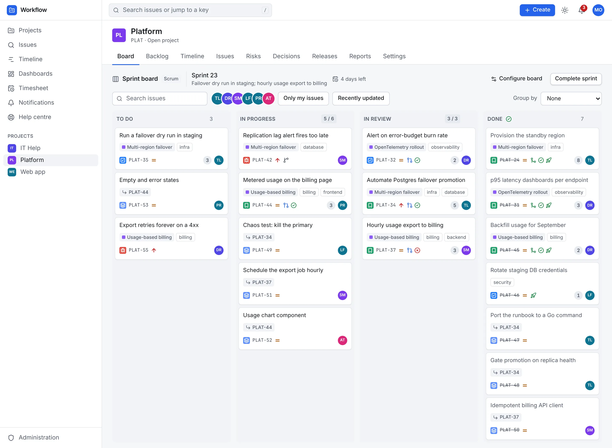

<div align="center">


# Workflow

**Issue tracking built for your own infrastructure.**

A free, open-source issue tracker for software teams: one container image, PostgreSQL and a Helm
chart, on k3s or EKS, including networks with no internet access.

[](https://github.com/workflowproj/workflow/releases/latest)
[](https://github.com/workflowproj/workflow/actions/workflows/security.yml)
[](LICENSE)
[](https://docs.workflowproj.io/reference/api/)
[](https://docs.workflowproj.io/)

[Website](https://workflowproj.io/) ·
[Documentation](https://docs.workflowproj.io/) ·
[Getting started](https://docs.workflowproj.io/getting-started/) ·
[API reference](https://docs.workflowproj.io/reference/api/) ·
[Releases](https://github.com/workflowproj/workflow/releases)

</div>

<picture>
  <source media="(prefers-color-scheme: dark)" srcset=".github/assets/board-dark.webp">
  
</picture>

Workflow covers what a team tracks day to day, from the backlog to the pull request, plus a service
desk for requests from outside the team. There is one edition, with every feature: no paid tier, no
feature gates and no licence keys.

## Contents

- [Features](#features)
- [How it runs](#how-it-runs)
- [Quick start](#quick-start)
- [Documentation](#documentation)
- [Contributing](#contributing)
- [Security](#security)
- [Licence](#licence)

## Features

- **Projects and issues**: project keys and templates; epics, stories, tasks, bugs and sub-tasks;
  custom fields, links, attachments, watchers and a full history.
- **Workflows as code**: versioned YAML with CEL conditions and validators, transition screens and
  post-functions, edited visually or applied from CI.
- **Boards and planning**: Scrum and Kanban boards with WIP limits and swimlanes, a ranked backlog,
  sprints, releases and a timeline across projects, updated live.
- **Releases**: a page per release with progress, a burnup and readiness checks before you ship,
  release notes generated from done issues and published to the help centre, Git tags and the
  environments a release reached.
- **Risks and decisions**: a risk register scored by likelihood × impact with a heat map, and a
  decision log with ADR export, in their own project tabs and out of sprint planning; work links
  to the risks it mitigates and the decisions it implements.
- **Search**: a JQL-like query language compiled to SQL, with saved and shared filters.
- **Reports and dashboards**: lead and cycle time, burndown and burnup, velocity, cumulative flow
  and breakdowns, on personal and shared dashboards.
- **Time tracking**: estimates, work logs, a burndown in hours and a timesheet.
- **Service desk**: service projects with a help centre for customers, request forms, queues, SLAs
  on business-hours calendars and approvals.
- **Automation**: rules on issue events, Git activity or a schedule, and signed outbound webhooks.
- **Git**: GitHub and GitLab (cloud or self-managed) linked to issues by key, with smart commits,
  pull and merge requests, pipeline status, tags and deployments.
- **Identity**: sign-in with any OpenID Connect provider, groups from sign-in tokens, single and
  back-channel logout, directory sync from Google Workspace or Keycloak, SCIM 2.0, and local
  accounts with two-factor authentication.
- **Notifications**: in the app and by email, immediately or in a daily digest, plus Slack and
  Mattermost channels.
- **API and AI assistants**: a REST API (OpenAPI 3.1), access tokens, and an MCP server so Claude
  and other assistants can work with issues as you.
- **Import from Jira**: Cloud or Data Center projects with their history, re-runnable while teams
  move across.

## How it runs

- One image in three modes, `web`, `hooks` and `worker`, so webhook bursts and background jobs
  scale apart from the UI. PostgreSQL is the only stateful dependency: the job queue, search and
  live updates run on it, and attachments can too.
- One Helm chart for k3s and EKS, with CloudNativePG, autoscaling (HPA and KEDA), NetworkPolicies,
  Ingress or Gateway API, External Secrets and Argo CD hooks for migrations.
- Only the `hooks` endpoint (Git webhooks, SCIM) needs to face the internet. Offline bundles cover
  air-gapped installs, and releases are signed with Cosign and carry SBOMs.
- Prometheus metrics with a Grafana dashboard and alert rules, OpenTelemetry traces and JSON logs.
  Searches, boards and reports are measured against 100,000 issues.

## Quick start

Workflow needs Kubernetes 1.30+ and the [CloudNativePG](https://cloudnative-pg.io/) operator. With
both in place, install the signed chart from the GitHub Container Registry:

```sh
kubectl apply --server-side -f \
  https://raw.githubusercontent.com/cloudnative-pg/cloudnative-pg/release-1.30/releases/cnpg-1.30.1.yaml
```

<!-- x-release-please-start-version -->
```sh
helm install wfm oci://ghcr.io/workflowproj/charts/wfm --version 0.1.0 \
  --namespace wfm --create-namespace -f values.yaml
```
<!-- x-release-please-end -->

Start `values.yaml` from the [k3s](deploy/helm/wfm/values-k3s.yaml) or
[EKS](deploy/helm/wfm/values-eks.yaml) example. [Getting started](https://docs.workflowproj.io/getting-started/)
walks through a first install, and [Deployment](docs/deployment.md) covers sign-in, TLS, backups,
upgrades and air-gapped installs. To run Workflow from source, see
[Contributing](CONTRIBUTING.md#run-it-from-source).

## Documentation

The reference pages live in [`docs/`](docs/) and are published at
[docs.workflowproj.io](https://docs.workflowproj.io/), with the
[API reference](https://docs.workflowproj.io/reference/api/) generated from
[`api/openapi.yaml`](api/openapi.yaml).

| Topic | |
|---|---|
| [Architecture](docs/architecture.md) | Components, modes, data flow, the job queue and live updates |
| [Deployment](docs/deployment.md) | Kubernetes with Helm, upgrades, backups, air-gapped installs |
| [Configuration](docs/configuration.md) | Every `WFM_*` environment variable |
| [Sign-in and provisioning](docs/identity.md) | OpenID Connect, SCIM, Google and Keycloak directory sync, local accounts, roles and tokens |
| [Workflows as code](docs/workflows.md) | The YAML format, CEL reference, versioning and migration |
| [Releases](docs/releases.md) | Release pages, readiness, release notes and What's new, tags and deployments |
| [Search](docs/search.md) | The query language |
| [Risks and decisions](docs/risks-decisions.md) | The risk register, the decision log, scoring and their links |
| [Metrics and dashboards](docs/metrics.md) | Issue timing, sprint reports, flow metrics, dashboards |
| [Time tracking](docs/time-tracking.md) | Estimates, logging work, the hours burndown and the timesheet |
| [Service desk](docs/service-desk.md) | Help centre, customers, request types, queues, SLAs and approvals |
| [Automation and webhooks](docs/automation.md) | Rules, actions, outbound webhook signatures |
| [GitHub and GitLab](docs/scm.md) | Connecting a GitHub App or GitLab, smart commits, write-back, tags and deployments |
| [Notifications and email](docs/notifications.md) | Email preferences, immediate emails, daily digests, unsubscribe |
| [Slack and Mattermost](docs/chat.md) | Channel notifications and the `/wfm` command |
| [AI assistants (MCP)](docs/mcp.md) | Connecting Claude and other assistants; the tools |
| [API](docs/api.md) | REST API, authentication, errors, live events |
| [Import from Jira](docs/import.md) | Moving projects across with their history; placeholders for people |

## Contributing

Bug reports, ideas and pull requests are welcome: use the
[issue forms](https://github.com/workflowproj/workflow/issues/new/choose) for bugs, features and
documentation problems. [CONTRIBUTING.md](CONTRIBUTING.md) covers running Workflow from source, the
code generators, migrations, the tests, the local Kubernetes loop and how releases are versioned.

## Security

Please report vulnerabilities privately through
[GitHub's private reporting](https://github.com/workflowproj/workflow/security/advisories/new),
not in a public issue. [SECURITY.md](SECURITY.md) lists the supported versions and how the code is
checked.

## Licence

Workflow is free and open source under the [Apache License 2.0](LICENSE); see [NOTICE](NOTICE)
for attributions.

Jira is a trademark of Atlassian. GitHub, GitLab, Slack, Mattermost, Google and other names are
trademarks of their respective owners. Workflow is not affiliated with, endorsed or sponsored by
any of them; their names are used only to describe compatibility.
